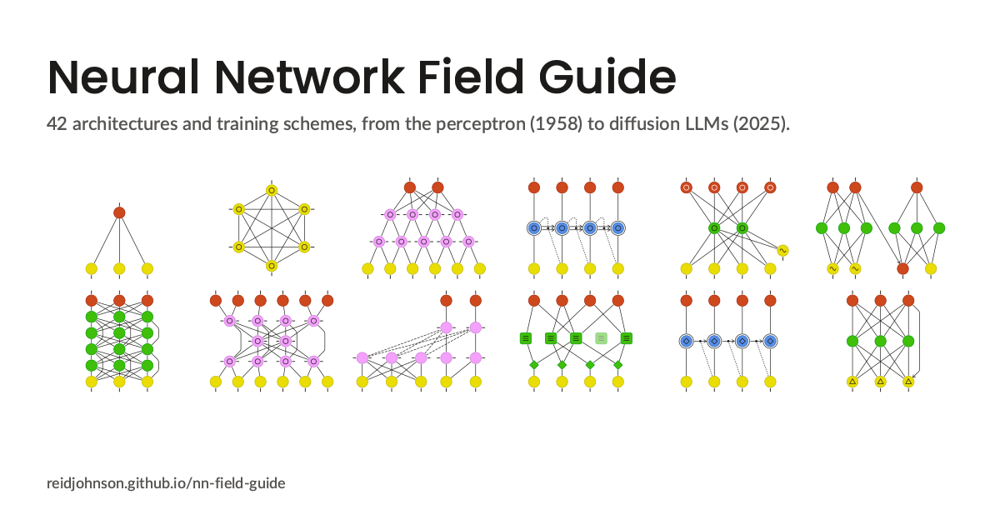

# Neural Network Field Guide

[](https://reidjohnson.github.io/nn-field-guide/)

**[See the guide](https://reidjohnson.github.io/nn-field-guide/)** · [Poster (PDF)](https://reidjohnson.github.io/nn-field-guide/neural-network-field-guide.pdf)

A reference chart of 42 neural network architectures and training schemes, from the perceptron (1958) to diffusion LLMs (2025). Inspired by *The Neural Network Zoo*, it draws every network in miniature, with each cell's role shown by both a color and a mark, so it reads with or without color and for color-blind readers.

## How to read it

Each panel runs from input at the bottom to output at the top. A circle is one unit (in sequence models, one token's vector); a square is something bigger, such as an image patch or a whole expert network. Faded cells and links take little or no part in the step shown. The poster's legend and the page explain every mark; in short:

| Job | Color | Mark |
|---|---|---|
| Input: data coming in | yellow | a stem below |
| Hidden: transforms what it receives | green | none |
| State: carries memory between steps | blue | an outer ring |
| Mixing: mixes across positions | pink | a tick on each side |
| Output: what the network produces | red | a stem above |

## Building it

Everything is drawn by `guide.py` from `architectures.yaml`, so the panels, the poster, and the page always match. It needs Python 3.10 or newer, and for exact PDF and PNG output the fonts Poppins, Lato 2.0 (from latofonts.com, for its Medium weight), and Noto Sans Mono.

```sh
pip install -r requirements.txt
pre-commit install               # once: format and check each commit
python guide.py build --strict   # lint, then write dist/
python guide.py lint             # checks only
```

Lint checks every drawing (lines that stray near cells, marks that touch, text too wide for its column) and the metadata. The "Last updated" date and the subtitle's count and range fill themselves in.

Three more scripts help weigh changes before making them. They write to `proofs/`, a local folder that isn't committed:

```sh
python revision.py --snapshot    # before a round of changes
python revision.py               # every panel that changed since, before and after
python proposals.py              # draft changes from proofs/proposals.yaml, not applied
python palettes.py               # the chart in other color schemes, as color-blind readers see them
```

## Adding an architecture

Add an entry under `architectures:` and list its id in a section. Rows run from the bottom (inputs) to the top (outputs), and layout is automatic. The comment at the top of `architectures.yaml` lists every option.

```yaml
  bert:
    name: BERT
    year: 2018
    caption: Every token sees every token     # one line, checked for width
    objective: masked token                   # one of OBJECTIVES in guide.py
    summary: A Transformer encoder on its own...
    papers:
      - {cite: Devlin et al. 2018, title: "BERT: ...", url: "https://arxiv.org/abs/1810.04805"}
    diagram:
      rows:
        - {cell: [input, input, mask, input]}
        - {cell: attention, n: 4, connect: full}
        - {cell: attention, n: 4, connect: full}
        - {cell: output, n: 4, connect: one, dim: [0, 1, 3]}
```

## Publishing

GitHub's runners don't have the fonts, so build locally, commit `dist/`, and push to `main`; the `pages` workflow publishes the page, posters, and panels to GitHub Pages.

## License

- **Code: MIT** ([`LICENSE-MIT`](LICENSE-MIT)): the Python scripts and the scripts and styles they write into the pages.
- **Everything else: CC BY-SA 4.0** ([`LICENSE-CC-BY-SA-4.0`](LICENSE-CC-BY-SA-4.0)): the chart, its text and diagrams, and this README. You may share and adapt it, commercially too, if you credit it, say what you changed, and release your version under the same license.

To credit it: *Neural Network Field Guide* by Reid Johnson, licensed under [CC BY-SA 4.0](https://creativecommons.org/licenses/by-sa/4.0/), with a link to [github.com/reidjohnson/nn-field-guide](https://github.com/reidjohnson/nn-field-guide). Contributions are accepted on the same terms. *The Neural Network Zoo* belongs to its authors and isn't covered by either license; the fonts keep their own, the SIL Open Font License.
